<!-- Generated by studio/readme.mjs from profile.config.mjs. Edit the config, not this file. -->

<a href="https://vijayrajdev.github.io/vijayrajdev/live/">
  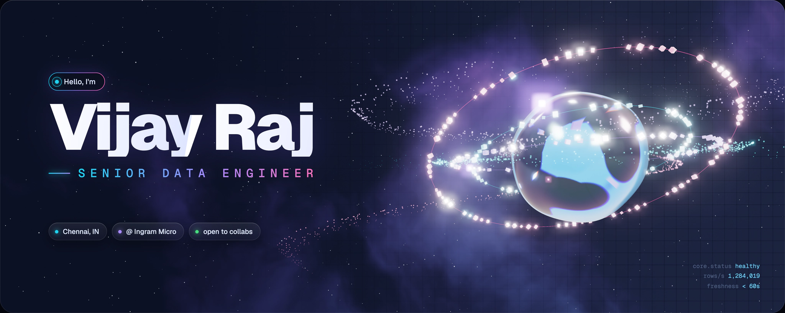
</a>

  

  
  
  
  
  
  

 

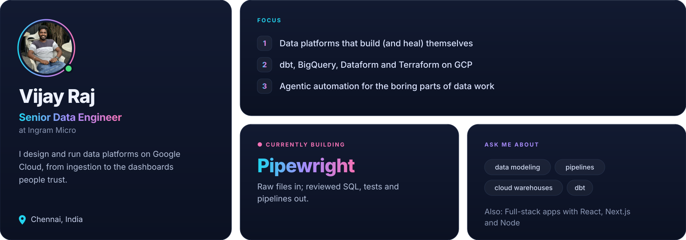

 

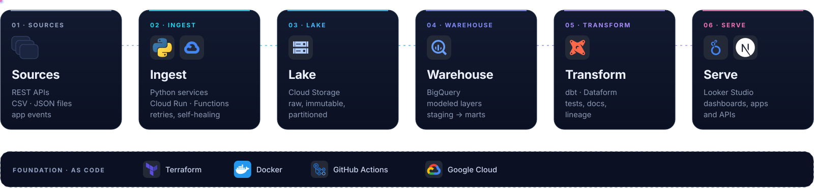

 

  <a href="https://github.com/Vijayrajdev/Pipewright">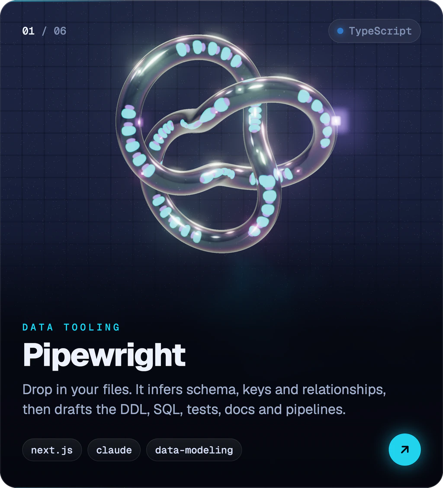</a>
  <a href="https://github.com/Vijayrajdev/sentinel">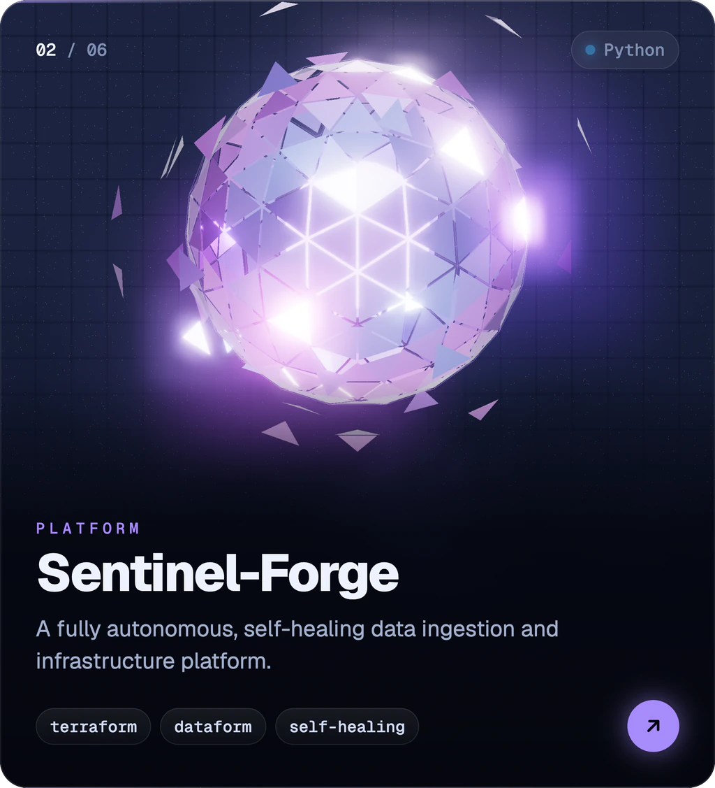</a>
  <a href="https://github.com/Vijayrajdev/nexus-autonomous-data-engine">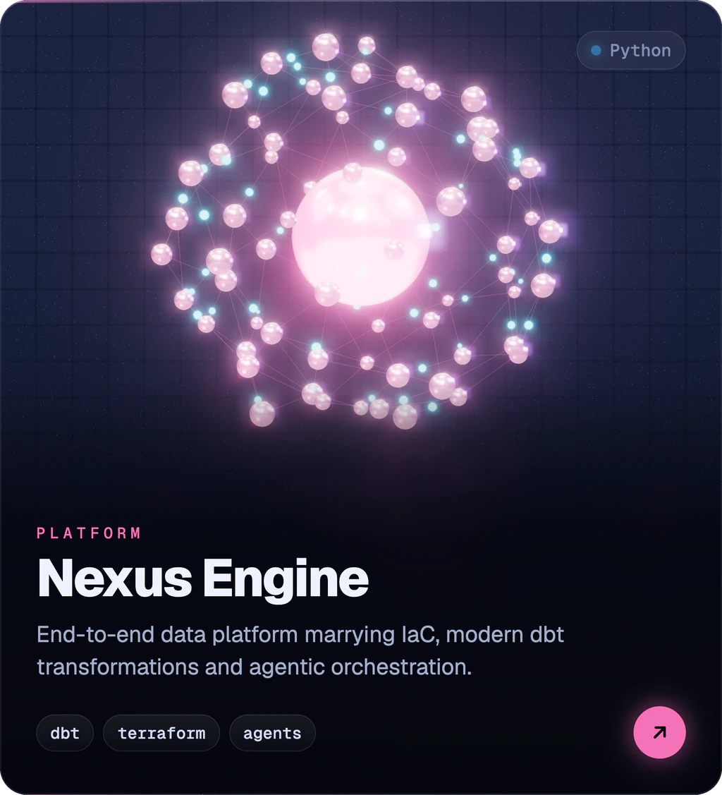</a>
  <a href="https://github.com/Vijayrajdev/vijayrajck-portfolio">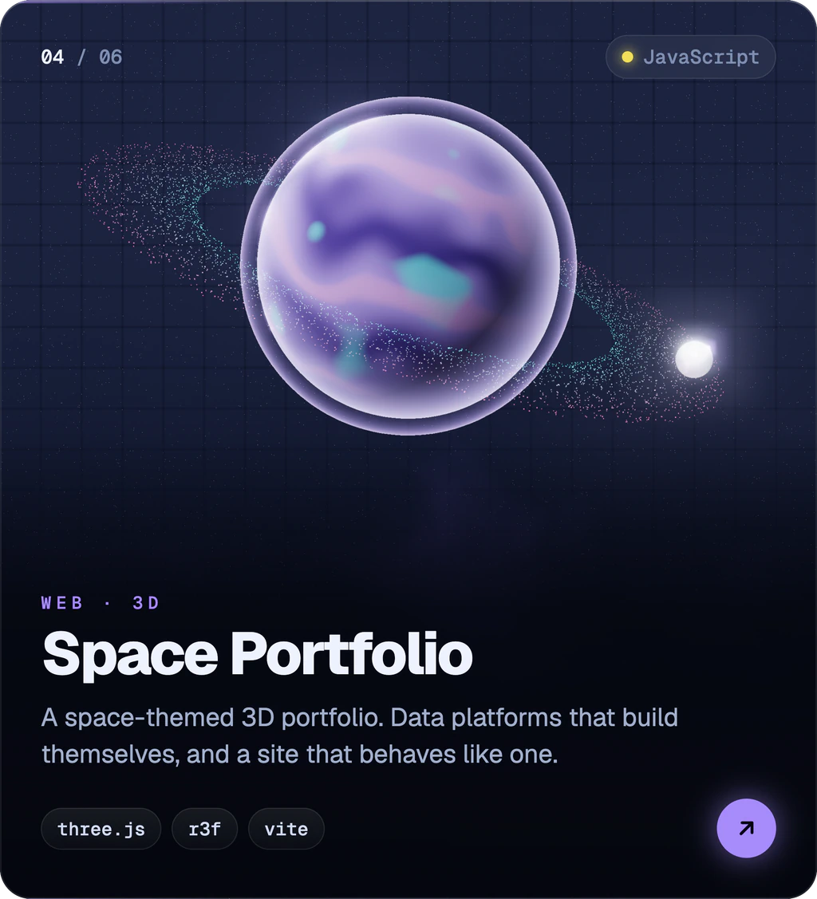</a>
  <a href="https://github.com/Vijayrajdev/mac-cleanup">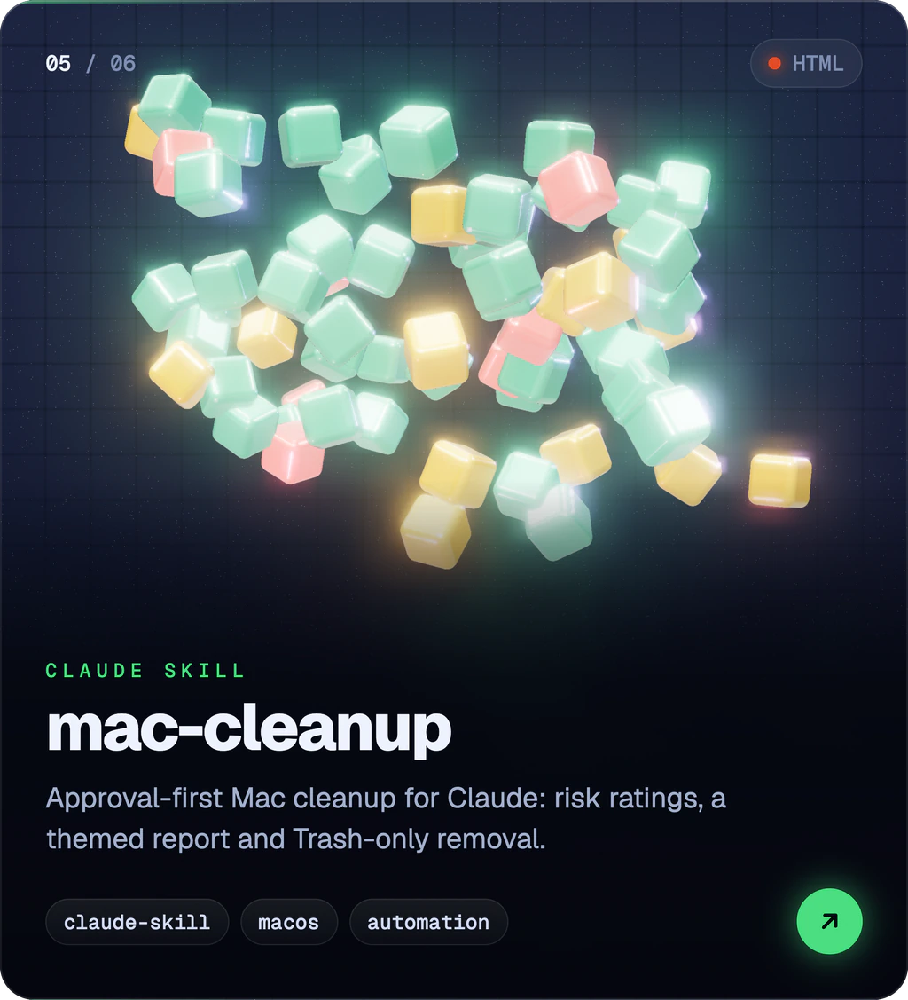</a>
  <a href="https://github.com/Vijayrajdev/pc-deepclean">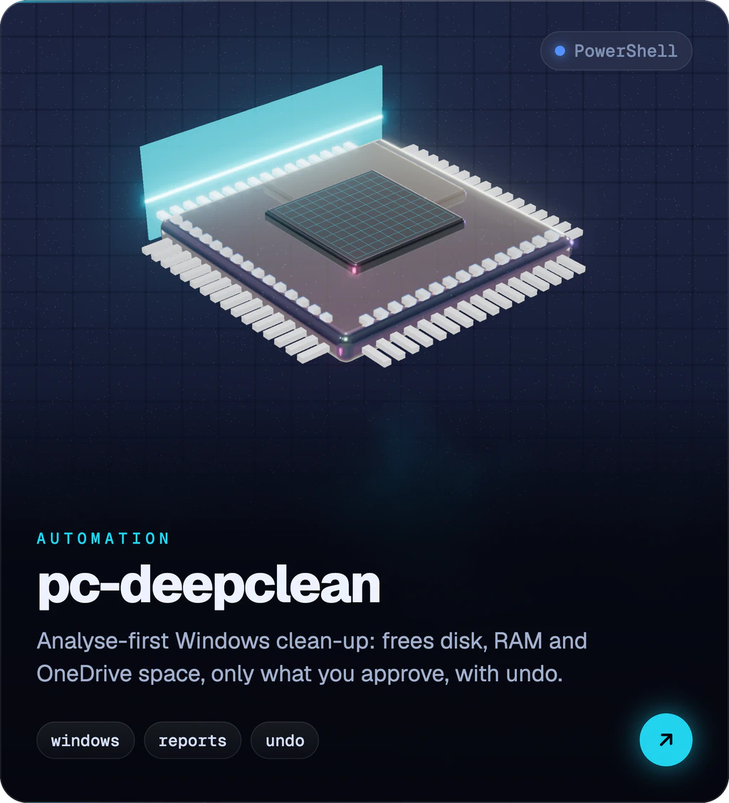</a>

 

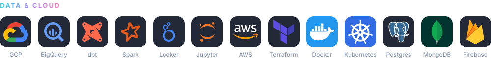
 
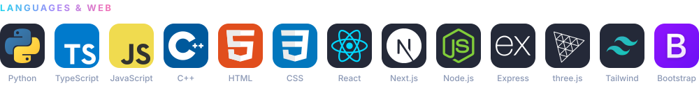
 
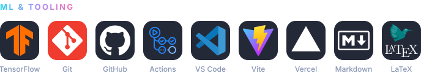

 

<a href="https://github.com/Vijayrajdev/vijayrajdev/issues/new?title=galaxy%3A+leave+a+star&body=Just+hit+%22Create%22.+A+bot+will+add+your+star+to+the+galaxy+and+close+this+issue+in+about+a+minute.+%E2%9C%A6">
  
</a>

  

 

  
  

<picture>
  <source media="(prefers-color-scheme: dark)" srcset="https://raw.githubusercontent.com/Vijayrajdev/vijayrajdev/output/snake-dark.svg" />
  <source media="(prefers-color-scheme: light)" srcset="https://raw.githubusercontent.com/Vijayrajdev/vijayrajdev/output/snake-light.svg" />
  
</picture>

  
<b>More stats</b>: activity, PRs, achievements, topics

   
  

    
    
    
    
    
  

 

  
<b>Daily break</b>: today's cartoon and joke

   
  

    
    
  

 

  Rendered in three.js, recorded frame by frame, kept alive by GitHub Actions. <a href="docs/GUIDE.md">Make one like it</a>.
   
  

